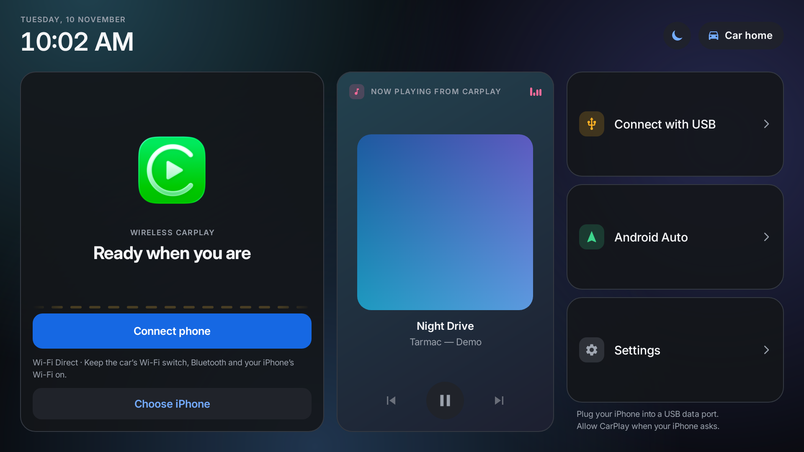
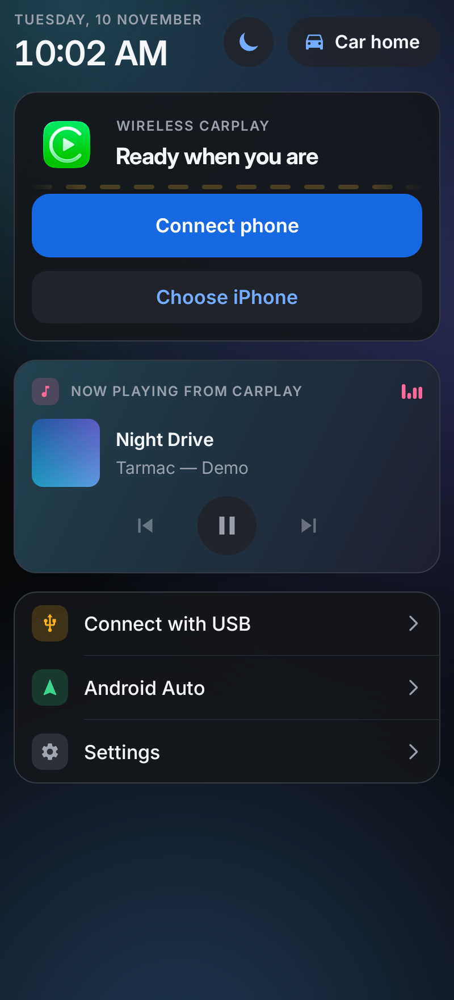
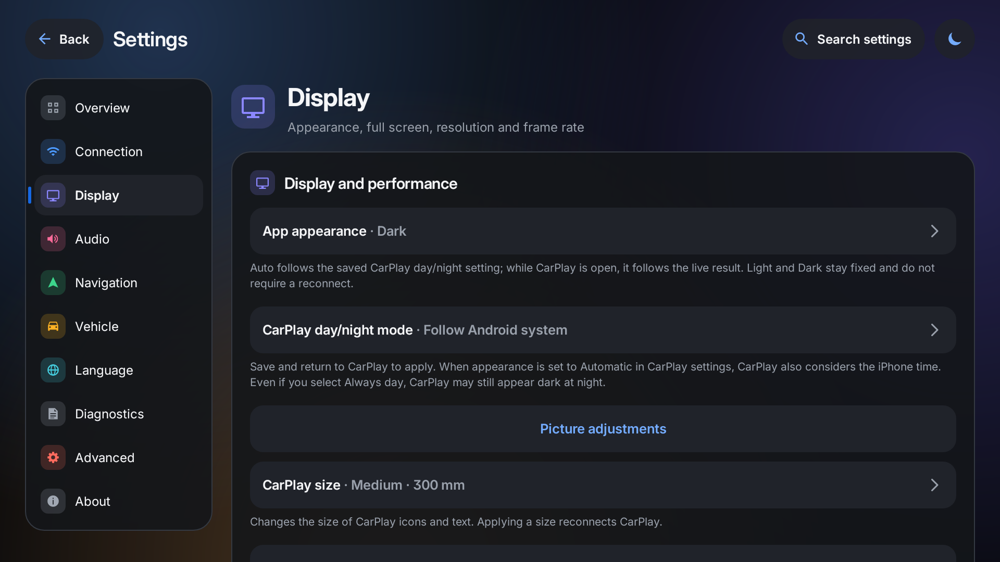

# Tarmac

**CarPlay and Android Auto for Android head units and phones.**

Tarmac turns an Android head unit, or an Android phone or tablet mounted in the car, into a CarPlay screen for your iPhone, and an Android Auto screen for Android phones (experimental). Install it on the head unit, not on the iPhone. You don't need a dongle, a Mac or an account.

<p align="center">
  
  &nbsp;
  
</p>

> **Early test release.** Tarmac 0.5.0 gives the app a new look. It builds on 0.4.0, which was tested on an Android phone with an iPhone, and **not yet on a DUDU or FYT head unit**. The new screens were checked on an Android emulator and in screenshots at head-unit and phone sizes, not yet in a car. Reports from real cars are very welcome; see [Reporting problems](#reporting-problems).

## Features

- **CarPlay, wireless and wired.** It connects over Wi-Fi Direct, the head unit's hotspot or a shared Wi-Fi network, or over USB, and it can connect automatically when your iPhone's Bluetooth connects.
- **Android Auto (experimental).** Wired, plus wireless with Bluetooth auto-start. It can use the car's GPS instead of the phone's.
- **A Home screen made for the car:**
  - the CarPlay status and connect buttons, with a centre line that streams while Tarmac connects;
  - a Now Playing card with controls;
  - the next turn while a route runs;
  - USB, Android Auto and Settings as large tiles;
  - a background that takes calm colours from the album cover;
  - light and dark, with smooth changes between pages.
- **CarPlay Ultra (experimental, off by default).** The iPhone shows climate in the CarPlay dock, and with CarPlay Ultra chosen on the iPhone, its Climate, Radio and Vehicle apps.
  - On TEYES and FYT units, the climate comes from the head unit. Climate changes from the iPhone are a separate opt-in.
  - The unit's FM stations are passed to the Radio app too, but its screen stays blank for now: iOS wants a car maker's theme for it.
  - The Vehicle app shows the car data Tarmac already reads, such as charge, range, odometer and tyres. Read only.
  - All of this is built from the head units' firmware and has run only on a phone so far. See [docs/CARPLAY_ULTRA.md](docs/CARPLAY_ULTRA.md).
- **Music and directions in Android.** CarPlay's songs appear in the notification shade, on the lock screen and in launcher music widgets, and Apple Maps turns appear as a navigation notification.
- **Works on more devices:**
  - Phones and tablets get sensible defaults, such as a CarPlay size that matches the screen.
  - Head units have adapters for BYD, Geely/ECARX, TEYES and FYT/DUDU: start with the car, steering-wheel keys, reversing-camera hand-off, and the dashboard map on a second screen.
  - On TEYES and FYT units, a CAN-box card shows what your car's profile can show on the cluster or HUD.
  - On rooted FYT and TEYES units, Tarmac can use the head unit's own Apple authentication chip.
- **Make it yours:**
  - accent colour;
  - CarPlay car-button icon and name;
  - CarPlay size, dock side and right-hand drive;
  - navigation prompts and calls from the driver's side speakers (experimental);
  - day/night mode;
  - an album-colour background you can turn off.

<p align="center"></p>

## Install

1. Download the latest `Tarmac-x.y.z.apk` and install it on the head unit or phone. Allow installs from unknown sources if Android asks.
2. Run one projection app at a time: close the head unit's built-in CarPlay app (ZLink, TLink and similar) while you use Tarmac.
3. Open Tarmac and follow the setup.

Android 7.0 or later is required.

## Connect

- **Wireless CarPlay:**
  - Pair your iPhone with the head unit's Bluetooth, then tap **Connect phone**.
  - Wi-Fi Direct is the simplest choice on phones.
  - If you use the head unit's own hotspot, the hotspot name and password in **Settings → Connection → Connection setup** must match the hotspot exactly.
- **Wired CarPlay:** plug the iPhone into a USB data port and allow CarPlay when the iPhone asks. On a phone, use a USB OTG adapter, or set Android's USB preference to "This device".
- **Android Auto:** connect the Android phone by USB, or turn on wireless Android Auto in **Settings → Advanced**.

[docs/INSTALL.md](docs/INSTALL.md) and [docs/CONNECTION_SETUP.md](docs/CONNECTION_SETUP.md) cover each connection in detail.

## Reporting problems

1. Reproduce the problem.
2. Open **Settings → Diagnostics → Save diagnostic report**.
3. [Open an issue](https://github.com/Altair571/tarmac/issues/new/choose), attach the `.txt`, and include:
   - the head unit model and firmware, or the phone model and Android version;
   - the iPhone or Android phone model and its OS version;
   - wireless or wired;
   - what you did and what happened.

Reports stay on the device until you choose to share them. See [docs/PRIVACY.md](docs/PRIVACY.md).

## Build from source

```sh
./gradlew :mobile:assembleDebug
```

Set `ANDROID_HOME`, or `sdk.dir` in `local.properties`. Source builds contain no accessory identity and cannot complete CarPlay authentication on their own. A personal build picks one up from a git-ignored `local-auth/offline-mfi/` folder, or from `DIPLAY_AUTH_ASSETS_DIR`. It can also authenticate through an Apple chip on a CH341 USB adapter or the head unit's own I2C bus. See [docs/BUILD.md](docs/BUILD.md).

Before a change is done, run the checks in [AGENTS.md](AGENTS.md).

## Status and legal

- **Not certified.** Tarmac is not certified by Apple or Google.
- **Accessory identities.** Release APKs bundle an experimental CarPlay accessory identity recovered from public Carlinkit firmware, the same one the upstream DiPlay project ships. From 0.4.1 they also bundle the Android Auto head-unit certificate published by [open-headunit](https://github.com/andreknieriem/open-headunit) (`O=Google-Android-Reference`). Their private keys can be extracted from the APK, and a future iOS or Android Auto update may stop accepting either.
- **Car controls.** CarPlay Ultra's own theme and gauges need a car maker's signed asset, which Tarmac does not have. The Ultra experiment covers climate, radio and car data instead. [docs/CARPLAY_ULTRA.md](docs/CARPLAY_ULTRA.md) and [docs/CAR_CONTROLS.md](docs/CAR_CONTROLS.md) explain what works.
- **Safety.** Use Tarmac at your own risk, and set it up while parked.

CarPlay is a trademark of Apple Inc., and Android Auto is a trademark of Google LLC. Tarmac is not affiliated with or endorsed by Apple, Google or any car maker.

## Credits and licence

Tarmac is a fork of [DiPlay](https://github.com/shihabal3amri/DiPlay) by shihabal3amri, which builds on [xcertplay](https://github.com/shilapi/xcertplay) (GPL-3.0) and adapts its home and settings UI from [DiAuto](https://github.com/shihabal3amri/DiAuto) (AGPL-3.0). It bundles the [Inter](https://github.com/rsms/inter) typeface (SIL Open Font License 1.1).

CarPlay's vehicle-state protocol in Tarmac (climate, radio and car data, part of the CarPlay Ultra experiment) is ported from LIVI (GPL-3.0-or-later). Based on LIVI by Lasse Heitgres (https://github.com/f-io/LIVI).

Tarmac is released under the GPL-3.0; see [LICENSE](LICENSE). The licences of the work it builds on are in [docs/THIRD_PARTY_NOTICES.md](docs/THIRD_PARTY_NOTICES.md) and [docs/licenses](docs/licenses). Keep those notices when you distribute modified versions.
