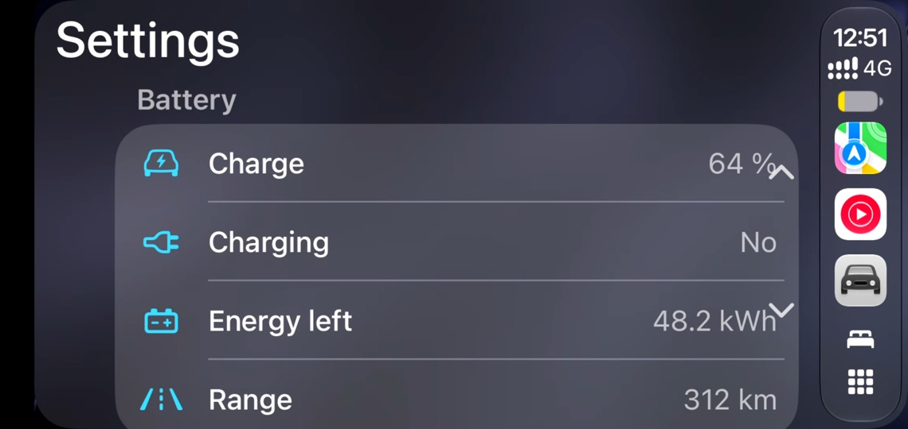
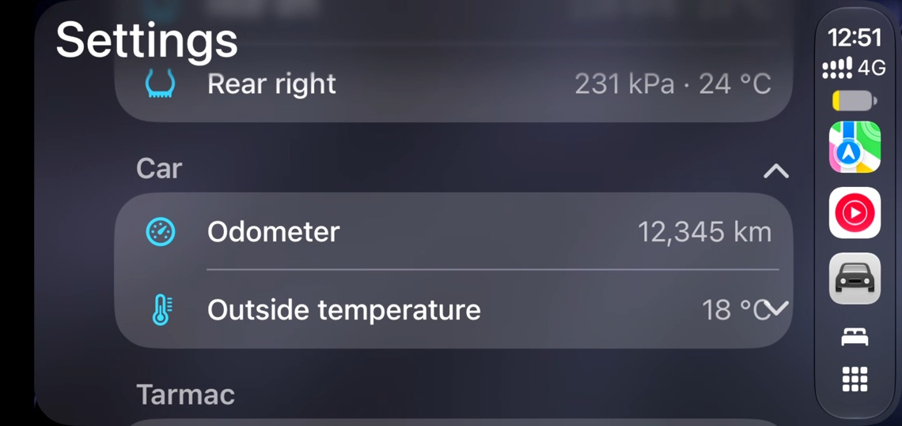

# CarPlay Ultra and CarPlay's vehicle state (experimental, November 2026)

CarPlay Ultra is Apple's "next-generation CarPlay". CarPlay draws the instrument cluster and other screens, uses
the car's theme, and shows the car's climate, radio and settings. This note records what makes iOS run it for an
accessory, what Tarmac now does, what an iPhone did, and what is left.

## Short answer

- **Climate in CarPlay works.** Tarmac now answers CarPlay's vehicle-state protocol (session feature
  `vehicleStateProtocol`). On standard CarPlay the iPhone then shows the driver and passenger temperatures in the
  dock, and a tap opens iOS's climate panel (A/C, recirculation, seat heating, SYNC, fan, AUTO, power). The
  iPhone's changes reach Tarmac.
- **With CarPlay Ultra chosen on the iPhone, the Climate, Radio and Vehicle apps appear too.** The Climate app shows
  driver and passenger controls. The Vehicle app is iOS's car **Settings** screen. Tarmac now fills it with the
  car's read-only data, grouped into Battery (or Fuel), Tyres, Car and Tarmac sections; see
  [Car data in the Vehicle app](#car-data-in-the-vehicle-app).
  - On TEYES and FYT units, Tarmac now describes the unit's own FM tuner in LIVI's media accessories.
  - iOS takes the stations and sends tune commands, but its Radio app's screen still draws nothing without a car
    maker's theme. See [Radio from the head unit](#radio-from-the-head-unit).
- **On TEYES and FYT head units the climate is the car's.** Tarmac reads the CAN box's climate through the vendor's
  service (TEYES `com.spd.carinfo`, FYT `com.syu.ms`) and sends it to the iPhone once a second.
  - With **Climate changes from the iPhone** on, the iPhone's allow-listed changes go back to the car: TEYES
    climate-button presses, or FYT voice-assistant commands.
  - Each change is checked against the car's next reading.
  - This is built from the firmware only and **has not run on a car**; see
    [Climate from the head unit](#climate-from-the-head-unit).
- **Elsewhere CarPlay shows no climate.** BYD has no climate source yet, and a phone has none, so Tarmac describes
  vehicle resources only.
- **The Ultra theme and gauges are out of reach.** iOS expects the car to name a per-vehicle theme asset, which it
  downloads signed from Apple. Asset IDs belong to car makers and are not published, and Tarmac does not borrow
  one. Without one, iOS runs Ultra with its own look.
- All of it sits behind Settings → Advanced → **CarPlay Ultra (experimental)**, off by default.

The protocol is ported from [LIVI](https://github.com/f-io/LIVI) (GPL-3.0-or-later). Based on LIVI by Lasse
Heitgres (https://github.com/f-io/LIVI).

## Results

iPhone 17 Pro Max, iOS 27.2, wireless, with a debug build of Tarmac 0.3.0 and this change on a Galaxy Note10+
(Android 12), 8–9 November 2026.

| Setup | What iOS did |
|---|---|
| Ultra chosen on the iPhone, Tarmac unchanged | CarPlayAvailability carried `themeAssets` = 1. iOS ran standard CarPlay: no asset was named, so nothing changed. |
| `vehicleStateProtocol` enabled, no `/info` entry for it | TEARDOWN right after `/info`, before any stream (in standard and Ultra mode). |
| `uiContext`, `uiSync`, `sessionManagement` or `fileTransfer` enabled | Same: TEARDOWN after `/info`. Their `/info` entries are not implemented. |
| `vehicleStateProtocol` with `vehicleStateProtocolInfo` and `displayPanels`, standard CarPlay | Session runs. iOS opens both vehicle-state streams, reads the description and follows every climate and seat value. Temperatures appear in the dock in portrait; the climate panel works; writes arrive (`hvacOn`, `driverTargetTemperature`). |
| The same with Ultra chosen on the iPhone | Session runs. Radio, Climate and Vehicle apps appear. The Climate app shows driver and passenger controls; Radio and Vehicle are blank. |
| Plus LIVI's fuel (1536), trip computer (1792) and tyres (2048) accessories, fed sample values | Session runs. iOS follows fuel level, fuel range, remaining range and odometer the moment the session starts, before any app opens; it never follows the tyres. **The Vehicle app stays empty**: it is a "Settings" screen, and none of these accessories appear there. |
| Plus LIVI's automaker settings (1280): one "Tarmac" section with read-only lines | iOS follows every line's `settingValue`. The Vehicle app shows the section with each label, value and SF Symbol (Version, Charge, Range, Odometer, Tyre pressures), and updates the values live. |
| Several sections (Battery, Tyres, Car, Tarmac), a row per tyre | iOS shows each section under its name, in `sectionSortOrder`, rows in `settingSortOrder`. Ten lines, all followed and updated. |

Other observations:

- In landscape CarPlay puts its dock on the driver's side as a vertical bar, without temperatures. Tarmac's
  **CarPlay dock → Bottom** setting gives a horizontal dock in landscape.
- After a teardown the iPhone reconnects on the stored pairing. Its `/info` request then carries
  `stopSessionReasons [1, 2]` (16-byte integers), and it ends every session, whatever Tarmac offers, for about two
  minutes. Then it re-pairs and works again. Test one change per fresh pairing.
- After about 25 failed Ultra sessions, iOS turned the Ultra option for Tarmac off by itself.
- The "CarPlay Ultra / CarPlay" choice at setup is what iOS's strings call the "enhanced integration" prompt
  (inferred from its name).

## Car data in the Vehicle app




*Sample values from the debug-only test switch below, on the Note10+; not a car's readings.*

**What fills the Vehicle app.** Its only content is LIVI's *automaker settings* accessory (1280): read-only lines
(service `0x1600_0015`, eight ids each: identifier, label, value, category, SF Symbol name, sort order, section) and
sections (`0x1600_0020`: identifier, sort order, name). LIVI shows its version and build date there. iOS follows
each line's value, so a line whose value is mutable updates live, as LIVI's version-line symbol does. The fuel, trip
computer and tyre accessories do not appear in it. iOS follows fuel and range right away, so it probably uses them for
the cluster or for its own range display. That is not confirmed: the Note10+ has no cluster display.

**What Tarmac shows**, each only where a source on this head unit gives it:

| Section | Line | Source (read-only) |
|---|---|---|
| Battery (Fuel with an adapter's `fuel_pct`) | Charge or Fuel, % | BYD battery switch; car data adapter with Apple Maps EV data on, or its `fuel_pct` signal |
| | Charging, yes or no | BYD's BMS state; adapter `charging` signal |
| | Energy left, kWh | BYD on CAN-FD firmware |
| | Range, km | BYD; adapter `range_km`; TEYES CAN box |
| Tyres | Front left … Rear right, kPa (and °C) | BYD's tyre reader (temperatures on CAN-FD) |
| Car | Odometer, km | adapter `odometer_km` |
| | Outside temperature, °C | TEYES CAN box |
| Tarmac | Version; Car data from | always; the sources above |

Tarmac also describes LIVI's fuel (1536), trip computer (1792) and tyre (2048) accessories with LIVI's ids, type
codes and units, for the same data, so iOS's own gauges get it. LIVI's fuel-efficiency service (1544) is left out:
no source reads consumption.

**Never an invented value.** LIVI describes every accessory and starts at 0. Tarmac:

- describes a kind of data only where a reader for it is set up *and* has given it once on this head unit
  (`carplay_ultra_car_data_seen`), so a gauge nobody fills never appears. Data first read during a connection is
  described from the next one;
- leaves a reading unset until the car gives one: the iPhone gets "no value" (−6727), a line reads "—", ranges stay
  hidden and tyre sensors stay "waiting";
- hides a range again, sets the tyre sensors back to waiting and puts "—" in a line when its source stops answering;
- counts the charge as the fuel gauge only where the iPhone is already told the car is electric (BYD's battery switch,
  the adapter's EV data), as LIVI does for electric cars. A TEYES CAN box's charge stays out: Tarmac cannot tell an
  electric car from a plug-in hybrid there;
- leaves out speed, gear and engine RPM. LIVI has no accessory for speed or gear (its RPM gauge needs the car's maximum
  and redline, which no source gives), and changing values do not belong on a settings screen.

**The setting.** Settings → Advanced → CarPlay Ultra (experimental) → **Car data in the Vehicle app**, shown once
Try CarPlay Ultra is on. On by default; applies at the next connection. Below it, a line says what the next connection
describes, or that nothing has been read yet.

**Sample values for testing without a car.** On a debuggable build, with the app stopped:

```sh
adb shell run-as <package> sed -i 's|<boolean name="carplay_ultra" value="true" />|&<boolean name="carplay_ultra_test_car_data" value="true" />|' shared_prefs/xcertplay_airplay.xml
```

Tarmac then describes everything and feeds `CarPlayCarData.TEST_READING` (64 %, 312 km, 12,345 km, 230/232/228/231
kPa, …); the source line reads "Sample values (test)". Release builds ignore the preference, and Settings never shows
it.

**What stayed blank or untested:**

- **Radio.** Not described. Tarmac has no tuner reader. The hardware exists on the head units: FYT's `com.syu.ms` has
  a radio module (1), and TEYES units have a Skyworks SI479X tuner behind TEYES's radio app. But Tarmac reads neither, and
  the Note10+ has none. Describing LIVI's media, now-playing and radio controls without one would give an empty
  Radio app or invented stations. Its controls (`tuneToFrequency`, `changeMediaSource`) are writes to the head
  unit and fall under [CAR_CONTROLS.md](CAR_CONTROLS.md#safety-rules-for-any-write-path).
- **The tyre accessory (2048)** was described and fed, but iOS never followed it in these sessions. The Tyres
  section of the Vehicle app shows the same pressures.
- **Real readings.** Every value above was the sample reading on a phone. BYD's battery and tyre readers, the
  adapter's `fuel_pct`, `odometer_km` and `charging` signals and the TEYES range and outside temperature are not yet
  checked against a car in this view.
- **Climate in Ultra with car data.** iOS followed no climate value in these Ultra sessions on a landscape screen; the
  climate controls themselves were not retested here.
- **Scroll arrows.** iOS draws its own up and down arrows over the right end of some values. Tarmac does not place
  them.

## How the vehicle-state protocol works

From LIVI's `livi-cp` crate (`vehicle_state.rs`, `vehicle_state/`, `info.rs`, `opack.rs`, `stack/`), confirmed on
the iPhone above.

1. **SETUP**: the iPhone proposes `vehicleStateProtocol`; the car enables it.
2. **`/info`** carries two more entries:
   - `vehicleStateProtocolInfo`: `{protocolVersion "1.0", pluginCount 1, pluginMapping {name: id},
     pluginConfigs [{name, pluginID, accessories}]}`.
   - `displayPanels`: one panel per display (`uid`, sizes, `properties`, `initialVideoStreams`), plus a cluster panel
     the car draws itself (`showsInstruments` and a `displayPlugins` entry, no stream).
3. **Data streams**: two type-130 streams, `3E2F3C61-AAD0-42CB-A8AA-BF22186DA62E` and the high-priority
   `FF4A6720-F2BE-4F56-A3E1-DB3B4E37D634`, keyed and framed like the iAP tunnel. The iPhone's packages are `sync`
   (answered with `rply`). The car sends `asyn` packages of type `cmnd`.
4. **Messages** are OPACK: `{pluginID, pluginData: OPACK {command, transactionID, values}}`.
   - `configRequest` → `configResponse` with the accessory list;
   - `registerRequest` (characteristic ids to follow) → `registerResponse` with the values;
   - `readRequest` → `readResponse`;
   - `writeRequest` (id → value) → `writeResponse` (0 written, −6727 refused), then `updateNotify` on the
     high-priority stream;
   - `controlRequest` for commands (radio tuning, images) → `controlResponse` (−6735 for unknown commands).
5. **Accessories** are HomeKit-like: accessory → services → characteristics. Each characteristic has an id, a type
   code, a format, a range, units (°C is 1082), an owner (car, phone or both) and an initial value. Tarmac
   describes climate (accessory 512), seats (1024) and vehicle resources (768) with LIVI's ids and type codes.

Apple's WWDC24 list of vehicle-state categories (Charging, Closures, Drive state, Fuel, Tire, Trip computer, Media,
Notifications, and others) matches LIVI's other accessories, which Tarmac does not describe yet.

## The setting

Settings → Advanced → **CarPlay Ultra (experimental)** → **Try CarPlay Ultra**. Off by default. It reconnects CarPlay.

When on, Tarmac:

- enables `vehicleStateProtocol` when the iPhone proposes it, adds the two `/info` entries and answers both data
  streams (`CarPlayVehicleState`);
- describes climate and seats only where the head unit reports them (below);
- declares a cluster display even when the dashboard map is off (the real one when found, otherwise the virtual
  1280×720 stream);
- accepts any other type-130 data stream it does not know and logs its packages, and logs every `/command`;
- fills the Vehicle app with Tarmac's version and, under **Car data in the Vehicle app**, the car's read-only data
  ([above](#car-data-in-the-vehicle-app)).

Phone writes reach `AirPlaySessionListener.onVehicleWrite(name, value)`, which accepts or refuses each one.
A refused write is answered with error −6727 and the car's value, so the iPhone's control goes back.

The card also says where climate comes from on this head unit. On TEYES and FYT it has a second switch,
**Climate changes from the iPhone**, off by default. It applies at once and does not reconnect.

For research without a car, a debug build can set `carplay_ultra_demo_climate` = true in
`shared_prefs/xcertplay_airplay.xml` (adb, app stopped). Tarmac then describes climate, seats and the radio anyway:

- it keeps the iPhone's climate values itself, as it did before head units were connected;
- it plays a radio with two sample FM stations.

For research, a comma-separated `carplay_ultra_features` string in `shared_prefs/xcertplay_airplay.xml` (debug
builds, `adb shell run-as`, app stopped) enables other proposed features as well: `uiSync`, `uiContext`,
`sessionManagement`, `fileTransfer`. With `uiContext` Tarmac adds `uiContextLastOnDisplayURLs` and
`uiContextNowOnDisplayURLs`, as xcertplay does. Each of these ends the session today.

Always on: Tarmac logs the SETUP proposal (`airplay SETUP features proposed=… enabled=…`), extra CarPlayAvailability
parameters (`iap2 4300 extras=[2:…]`), and the raw bytes of an `/info` request that does not decode. Its plist
decoder now reads the 16-byte integers iOS 27 uses in `stopSessionReasons`.

## Theme assets

From iOS's own strings (the iOS 27.0 Simulator runtime in Xcode 27, `carkitd` and the dyld cache, read as data)
and Tarmac's iAP2 catalog:

- A vehicle has `supportsEnhancedIntegration` and `supportsThemeAssets`. With Ultra chosen, the iPhone sends
  CarPlayAvailability parameter 2 (`themeAssets`) = 1.
- The car names its theme in CarPlayStartSession: parameter 6 `SDKVersion`, 7 `clusterAsset` {`assetID`,
  `assetVersion`}, 8 `mutualAuth`. `carkitd` logs `{… sdkVersion, assetID, assetVersion}` and CarKit
  `no clusterAssetIdentifier for vehicle %@`. LIVI sends a theme only when one is configured, and its iAP2
  identification has a `theme_asset_identifier` too.
- iOS downloads the asset from MobileAsset `com.apple.MobileAsset.CarDDPAssets` (Apple's server answers 403 for that
  catalog) and sends it to the car by file transfer. An asset carries a certificate, a signature and "accessory
  additions", and the car is expected to verify it (Apple, WWDC24).

Naming another car maker's asset would pose as that car to use that maker's design. Tarmac does not.

## Climate from the head unit

`CarPlayClimateLink` joins a head unit's `HeadUnitClimateSource` to `CarPlayVehicleState`. It starts when the
experiment is on and CarPlay starts.

**What is described.** The iPhone gets the accessory list once per session, at SETUP:

| Accessory | Described when |
|---|---|
| vehicle resources (768) | always |
| climate (512) | the head unit has a climate source and the car has reported its climate, now or on an earlier drive |
| seats (1024) | as climate, and a heated seat has been seen |

If a session runs for 30 seconds without a climate reading, Tarmac forgets the earlier drive. This covers a driver
who picked another CAN-box profile.

**Car → iPhone.** Once a second the link turns the latest reading into characteristics
(`CarPlayClimate.characteristics`) and calls `carSet` for each. `carSet` sends only changed values that the iPhone
follows. CarPlay's target range is 16–28 °C in 0.5 °C steps, so the car's LO and HI (and values outside the range)
show as 16 and 28. Fan levels are scaled to CarPlay's 0–7. A car's third seat-heating level shows as 2.

**iPhone → car.** `CarPlayClimate.command` is the allow-list:

| Characteristic | Command | Range checked |
|---|---|---|
| `driverTargetTemperature`, `passengerTargetTemperature` | target temperature | 16–28 °C, 0.5 °C steps |
| `fanLevel` | fan level | integer 0–7 |
| `compressorOn` | A/C | boolean |
| `maxACOn` | MAX A/C | boolean |
| `recirculationOn` | recirculation | boolean |
| `maxDefrostOn` | front defrost | boolean |
| `driverSeatHeatingLevel`, `passengerSeatHeatingLevel` | seat heating | integer 0–2 |

Tarmac refuses everything else, including power, AUTO, SYNC, fan auto and wrong types. It also refuses every write
when the switch is off, when the head unit cannot take writes, and after sending has stopped.

Accepted writes queue by characteristic, and a newer value replaces one still waiting. A single worker applies them
one at a time, at most 30 a minute and 300 ms apart. While a value is waiting, the car's readings for it are held
back, so the iPhone's control does not jump. The first failure stops sending for the rest of the session.

**TEYES.** Details and evidence are in [HEADUNIT_SPD_TEYES.md § Climate](HEADUNIT_SPD_TEYES.md#climate).

- *Reading:* `getInt` for the switches, fan and seat heating, and `getBundle` for temperatures (`value`, `unit`,
  `min`, `max`, `step`), per zone (0 driver, 1 passenger).
- *Writing:* a touch down then a touch up, the way TEYES's own climate widgets press a button:
  - `setInt(key, 0x20000 | action, zone)`, then 120 ms later `setInt(key, 0x10000 | action, zone)`;
  - the action is 0 for a switch or seat heating, `0x2000` for one step up and `0x4000` for one step down.
- *Checking:* each press is planned from the latest reading. Tarmac then waits up to 2.1 s for the car to report a
  change toward the target. Sending stops on no answer, on a change the wrong way, or after a command's press
  budget: 1 for a switch, 4 for a seat-heating cycle, 36 for temperature or fan.

**FYT.** Details and evidence are in [HEADUNIT_FYT_DUDU.md § Climate](HEADUNIT_FYT_DUDU.md#climate).

- *Reading:* callbacks on `com.syu.ms`'s canbus module for FYT's shared `U_AIR_*` codes. They are used only when the
  protocol reports `U_EXIST_AIR` and is not one that moves them.
- *Temperatures:* shown only in a scale that is certain (tenths of a degree, LO/HI markers). Otherwise Tarmac
  describes no climate.
- *Writing:* FYT's voice-assistant command `cmd(20, {vaCode, value})`, only for codes the protocol lists. A/C,
  defrost and recirculation are absolute; fan and temperature move one step a command.
- *Not offered on FYT:* MAX A/C and seat heating.

**BYD.** No climate source yet; see [CAR_CONTROLS.md](CAR_CONTROLS.md#climate-sources-by-head-unit).

## Radio from the head unit

`CarPlayRadioLink` joins a head unit's `HeadUnitRadioSource` to LIVI's radio accessories, ported in
`CarPlayVehicleState` and `CarPlayRadio.kt`:

- `media` (4096) has a DAB source (4097) and an FM source (4112). Each has an identifier, a semantic type, a disabled
  flag, the current item and a station list. The FM source adds the current frequency (87.5–108 MHz in 100 kHz
  steps), and the DAB source a station image list.
- `nowPlaying` (4352) holds the current source, title, artist, album, artwork and playback state.
- Its service also lists seven commands: `play`, `pause`, `nextItem`, `previousItem`, `tuneToIdentifier`,
  `tuneToFrequency` and `changeMediaSource`.

Large values (station lists, artwork) are described with `largePayload` and an `iidNotifier`. Every change bumps
the notifier counter (mod 256), which the iPhone follows.

The radio is described only where the head unit has a tuner source (or with the demo preference). Once a second,
the link sends the tuner's state (`carSetRadio`). Commands from the iPhone go to the tuner on a worker thread.

| | TEYES | FYT |
|---|---|---|
| Service | `com.spd.radio`, `IRadioAidlInterface`, exported, no permission | `com.syu.ms` radio module (1), and the main module's app ID |
| Reading | getters polled once a second (it pushes nothing on register): frequency, list, RDS PS and radiotext, status | callbacks: band, frequency, presets and their names, RDS PS and radiotext, and the app ID (1 = radio playing) |
| Station list | the band's list (`getList("FM")`) | FM presets |
| Tune | `setCommand(8193, kHz)`, after `8192` to FM when on AM | the matching preset (`C_SELECT_CHANNEL`), else `C_FREQ {3, f}` in 10 kHz; then `C_APP_ID {1}` |
| Next / previous | list entry up / down (4102 / 4101) | next / previous preset (0 / 1), then `C_APP_ID {1}` |
| Play / pause | `enterSource(…)` and `8199 {1}` / `8199 {0}` (releases TEYES's audio) | `C_APP_ID {1}` / `C_APP_ID {10}` (back to the third-party player FYT's CarPlay uses) |
| Audio | tuning takes TEYES's audio to the radio | the radio plays only while it is FYT's current app |

Further limits:

- **AM:** neither platform's AM fits CarPlay's FM or DAB sources, so on AM the station shows only as now-playing text.
- **DAB:** FYT has none. On TEYES, DAB+ comes from a USB dongle behind a separate service; its station-select command
  is unknown, so Tarmac leaves it out.
- **Never sent:** search, scan, save, region, reset and the tuner settings.

Every TEYES `setCommand` carries a Bundle, because several commands read it without a null check inside TEYES's
system service. Details: [HEADUNIT_SPD_TEYES.md § Radio](HEADUNIT_SPD_TEYES.md#radio) and
[HEADUNIT_FYT_DUDU.md § Radio](HEADUNIT_FYT_DUDU.md#radio).

While the tuner reports playing, Tarmac takes the main audio with `changeModes` (`resourceID` 2, take, priority
500). It gives the audio back when the tuner stops, as a car with its own radio does.

With the demo preference, two sample FM stations tune in Tarmac only.

**Tested on the Note10+ with the demo radio** (iPhone 17 Pro Max, iOS 27.2, CarPlay Ultra chosen, 9 November 2026).
The data path works:

- iOS reads the radio description and follows the station lists, current station and frequency, now-playing text and
  playback state.
- The dock shows the Radio app.
- iOS sent `tuneToIdentifier` for the demo stations once, and it accepted the main-audio take (`modesChanged` with
  `resourceID` 2 on the car).

**The Radio app's own screen stays empty**, and opening it sends nothing to Tarmac. That held in every variation
tried:

- with LIVI's `audio` (volume) accessory added; iOS did not even follow it;
- with the car holding the main audio;
- with the radio playing or paused.

LIVI turns on `uiSync` only when a car-maker theme is configured, and its tests check only the description. The
likely missing piece is therefore the theme / `uiSync` route, which needs a car maker's theme asset that Tarmac does
not borrow ([Theme assets](#theme-assets)). This is not confirmed.

### Not verified on a car

Everything here was read from TEYES's CC4 and FYT's UIS7870 firmware, and tested against a simulated CAN box. None
of it has run on a head unit with a car. In particular, these are open:

- whether every CAN-box profile fills the temperature bundle's range;
- how each profile answers a press;
- whether the iPhone shows refused writes cleanly;
- the radio, on any unit: band and list names, which tuner type an FYT unit uses, whether FYT's radio plays with only
  `C_APP_ID {1}`, and how the head unit's radio and CarPlay's own audio take turns. On the Note10+ the Radio app's
  screen stays empty (see [Radio from the head unit](#radio-from-the-head-unit));
- how the dock looks with only vehicle resources described.

The test device here, a Galaxy Note10+, has no CAN box, so on it Tarmac now describes no climate unless the demo
preference is set.

## What needs a real head unit

- Climate and seats on a TEYES unit with a car, to confirm the reading and the presses above.
- Climate on FYT and BYD, and radio on any unit: a backend per head unit. These are write paths and must follow
  [CAR_CONTROLS.md](CAR_CONTROLS.md#safety-rules-for-any-write-path).
- A second physical display for the cluster stream ([SECOND_DISPLAY_MAP.md](SECOND_DISPLAY_MAP.md)). The Note10+ has
  only the virtual stream.
- Real readings for current temperatures, and checking the Vehicle app's values (charge, range, energy, tyres,
  odometer, outside temperature) against the car's own display.
- FYT's tyre pressures: `com.syu.ms` has a TPMS module (8) that Tarmac does not read yet.

## Next steps

1. **Test TEYES and FYT climate on a car**: the reading first (the diagnostic report's `CarPlay climate:` lines and
   the dock), then each write with **Climate changes from the iPhone** on.
2. **BYD climate**: see [CAR_CONTROLS.md](CAR_CONTROLS.md#climate-sources-by-head-unit) for what it needs.
3. **Radio on a unit**: check the station list, tuning and the hand-over of audio between the radio and CarPlay; then
   TEYES DAB+ once its station-select command is known.
4. **Trip computer in the Vehicle app**: describe LIVI's fuel-efficiency service once a source gives consumption.
5. **Car data on a car**: compare the Vehicle app's lines with the car's own gauges on TEYES, FYT and BYD.
6. **Vehicle app settings that change the car** (TEYES, FYT): today every line is read-only. Real car settings
   would be writable lines, under the same rules as climate writes.

## Code

- `shared/.../airplay/CarPlayVehicleState.kt` (ported from LIVI): accessories, the `/info` entry and the message
  handling; `CarData`, `CarReading`, `SettingLine`, `Section` and `carReads` for the Vehicle app.
- `common/.../CarPlayCarData.kt`: which car data a connection describes, its lines and sections, and the feed that
  reads BYD, the adapter and the head unit every two seconds while the session runs. `Opack.kt` (ported from LIVI): OPACK. `AirPlayInfoPlist.displayPanels` (ported from LIVI).
- `CarPlayMediaEngine.vehicleStateStream`: the two streams. `VideoSettingsChannel`: `onMessage` and `send`.
- `AirPlaySession.vehicleState`, `/info` additions, `vehicleProfile`, `onVehicleWrite`.
- `CarPlayClimate.kt` (shared): `CarPlayVehicleProfile`, `CarClimateReading`, the characteristics mapping and the write
  allow-list. `CarPlayClimateLink` (common): source lifecycle, forwarding, the write queue.
- `headunit/HeadUnitPlatform.kt`: `HeadUnitClimateSource`, `HeadUnitClimateControl`. `headunit/SpdClimate.kt`: TEYES's
  keys, reading, press planning and the control. `headunit/FytClimate.kt`: FYT's codes, reading and voice commands.
- `CarPlayRadio.kt` (shared): radio reading, stations and commands. `CarPlayRadioLink` (common): the tuner and the demo
  radio. `headunit/SpdRadio.kt`, `headunit/FytRadio.kt`: the tuners.
- `CarPlayUltra.kt`: feature sets, the adb override, package logging. `CarPlayMediaEngine.ultraDataStream`: the probe.
- `Iap2CarPlayMessages.availabilityExtras`, `BplistCodec` (16-byte integers).
- `AirPlayPersistence.loadCarPlayUltra` / `loadCarPlayUltraFeatures`, `CarPlayHostActivity` (config and cluster),
  `DiPlayActivity` (`SettingsSection.CARPLAY_ULTRA` in Advanced, the LIVI line in About),
  `strings_carplay_ultra.xml` in every locale.
- Tests: `CarPlayVehicleStateTest`, `CarPlayClimateTest`, `CarPlayUltraTest`, `VehicleAdapterProtocolTest` (shared),
  `CarPlayCarDataTest`, `SpdClimateTest`, `FytClimateTest`, `HeadUnitRadioTest`, `AdaptiveSettingsUiTest` (common).

## Sources

- LIVI (GPL-3.0-or-later; NOTICE in `docs/licenses/LIVI-NOTICE.txt`):
  [README](https://github.com/f-io/LIVI/blob/main/README.md), release notes 9.3.0–10.4.0, screenshots, and source
  at commit `7a99e38` (`native/crates/livi-cp`, `livi-runtime`, `iap2-csm`), read with the user's approval.
- Apple: [WWDC24 10111](https://developer.apple.com/videos/play/wwdc2024/10111/),
  [WWDC24 10112](https://developer.apple.com/videos/play/wwdc2024/10112/),
  [WWDC25 216](https://developer.apple.com/videos/play/wwdc2025/216/),
  [CarPlay for developers](https://developer.apple.com/carplay/), [apple.com/carplay](https://www.apple.com/carplay/),
  [Newsroom, May 2025](https://www.apple.com/newsroom/2025/05/carplay-ultra-the-next-generation-of-carplay-begins-rolling-out-today/),
  [Support 102521](https://support.apple.com/en-us/102521).
- Press: [Auto Express](https://www.autoexpress.co.uk/features/367055/apple-carplay-ultra-review-next-generation-car-smartphone-mirroring),
  [heise](https://heise.de/-10495784), [MacRumors, August 2026](https://www.macrumors.com/2026/08/20/apple-where-is-carplay-ultra/).
- iOS 27.0 Simulator runtime (Xcode 27) strings, read as data; Apple's MobileAsset server for which catalogs are public.
- xcertplay (GPL-3.0, Tarmac's upstream): an earlier SETUP capture and the `uiContext` keys.
- Tarmac's own logs from the tests above.
